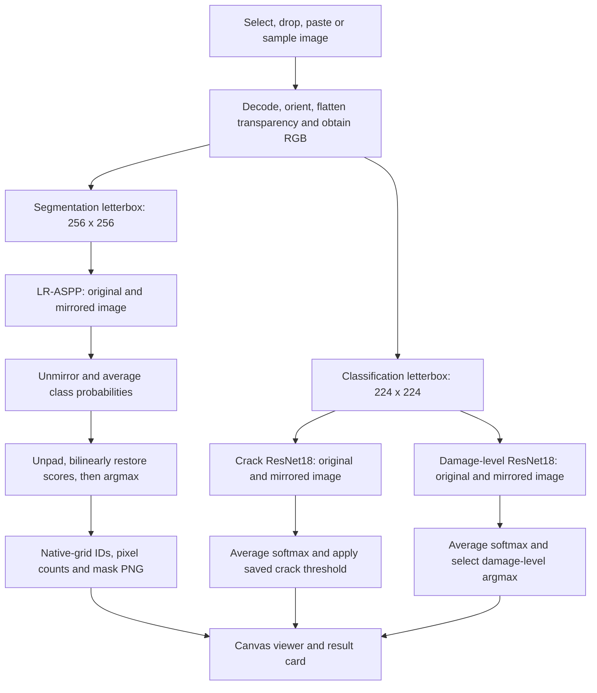

# Concrete — Damage Analytics and Severity Prediction Platform

**[Open the live application →](https://concrete-damage-severity.vercel.app/)**

An ML-powered visual inspection platform for analyzing visible damage in concrete photographs. The project combines **semantic segmentation**, **crack classification** and **component damage-level prediction** to turn an input image into interpretable masks, category predictions and image-space measurements.

## Overview

Concrete inspection involves several related questions: where visible damage occurs, whether a crack is present, and which damage-level category best describes the image. This project addresses those questions with complementary models trained on RC1841, SDNET2018 and PEER Φ-Net Task 7.

The workflow covers dataset validation and curation, transfer learning, reproducible checkpoint selection, ONNX model export and an interactive web application. Each prediction retains its own task meaning: damage categories, crack presence and visible component damage level are distinct outputs.

> This is a research and visual-analysis tool. Model confidence is uncalibrated, image coverage is not physical surface area, and component damage labels do not establish structural safety.

## Contents

- [Live application](https://concrete-damage-severity.vercel.app/)
- [Key capabilities](#key-capabilities)
- [Machine-learning models](#machine-learning-models)
- [Datasets and label definitions](#datasets-and-label-definitions)
- [Training methodology](#training-methodology)
- [Inference pipeline](#inference-pipeline)
- [Evaluation results](#evaluation-results)
- [Interpreting results](#interpreting-results)
- [Technology stack](#technology-stack)
- [Project structure](#project-structure)
- [Local setup and deployment](#local-setup-and-deployment)
- [Model artifacts and reproducibility](#model-artifacts-and-reproducibility)
- [Validation status and limitations](#validation-status-and-limitations)
- [Dataset references and licensing](#dataset-references-and-licensing)

## Key capabilities

- **Damage segmentation:** assign each image pixel to background or one of eight visible damage categories.
- **Crack classification:** estimate crack presence using a dedicated binary image classifier and a recorded decision threshold.
- **Damage-level classification:** predict Undamaged, Minor, Moderate or Heavy from a separately trained image classifier.
- **Interactive inspection:** select, drop or paste a photograph, or use one of three bundled examples. Accepted images are analyzed automatically.
- **Visual analysis:** compare Photo, Damage and Mask views, adjust overlay strength, inspect the color legend and download a class-ID mask.
- **Result summary:** view the damage-level label, crack decision, image-coverage headline and damage-level score distribution.

The current analysis produces pixel classes and image-level classifications. It does not produce connected-region counts, bounding boxes, geometric measurements or region-specific severity labels. Coverage and display behavior are explained under [Interpreting results](#interpreting-results).

## Machine-learning models

The analysis pipeline combines three complementary neural networks, each trained for a distinct task:

| Task | Architecture | Training dataset | Model input, NCHW | Source checkpoint | Selected epoch |
|---|---|---|---|---|---:|
| Damage segmentation | LR-ASPP with MobileNetV3-Large backbone | Curated RC1841 | `1 × 3 × 256 × 256` | `outputs/task09/experiments/lraspp_matched_s42/best.pt` | 21 |
| Crack presence | ResNet18, two-class head | SDNET2018 | `1 × 3 × 224 × 224` | `outputs/task07/experiments/sdnet_resnet_pilot/best.pt` | 5 |
| Visible damage level | ResNet18, four-class head | PEER Φ-Net Task 7 | `1 × 3 × 224 × 224` | `outputs/task10/experiments/phi7_resnet18_s42/best.pt` | 16 |

Model versions, input dimensions and dataset identities are recorded in the [model manifest](frontend/public/models/manifest.json).

The two ResNet18 models were fine-tuned separately and have different weights and targets. Their outputs are not a shared classifier or a learned fusion of the three datasets. All three see the image independently; the damage-level model receives image pixels, not segmentation areas or extracted RC1841 features.

### Segmentation architecture

LR-ASPP is a lightweight semantic-segmentation network: its MobileNetV3-Large backbone extracts image features and its low/high-resolution classifier heads produce nine per-pixel scores. Both heads were adapted to the project's nine labels. The selected run records **3,219,498 parameters**.

Training started from torchvision's `LRASPP_MobileNet_V3_Large_Weights.COCO_WITH_VOC_LABELS_V1`. These are initialization weights; the deployed graph contains the fine-tuned RC1841 weights. Batch-normalization running statistics were frozen during fine-tuning, while affine parameters remained trainable.

### Classification architectures

Both image classifiers use torchvision ResNet18 initialized from `ResNet18_Weights.IMAGENET1K_V1`. The final linear layer was replaced with two outputs for crack presence and four outputs for Φ-Net damage level. The application loads the exported fine-tuned weights directly for inference.

## Datasets and label definitions

### 1. RC1841 — segmentation

**Source:** [Reinforced concrete structure segmentation dataset 1841, Mendeley Data, version 1](https://data.mendeley.com/datasets/yfhwfcrfmk/1), DOI **10.17632/yfhwfcrfmk.1**.

The source provides 1,841 concrete photographs with pixel-annotation information for eight damage categories. In this project, image–JSON polygon pairs were validated and rasterized into class-ID masks for supervised segmentation.

| Local preparation statistic | Count |
|---|---:|
| Original image–annotation pairs | 1,841 |
| Included curated pairs | 1,617 |
| Excluded pairs | 224 |
| Training | 1,132 |
| Validation | 243 |
| Frozen test | 242 |

The selected dataset release is **`rc1841-curated-v1-d34771dbb662406a`**. Exclusion reasons include invalid/self-intersecting polygon rings, conflicting cross-class overlaps, out-of-bounds geometry and unresolved exact-image annotation conflicts. Reasons overlap; their individual counts must not be added to infer the number of excluded samples.

Source resolutions vary: the curated dimensions report spans widths **168–4,187** and heights **159–4,160** pixels. Training works at 256 × 256 after cropping/letterboxing; prediction masks are restored to the processed input grid.

#### Segmentation labels, colors and training imbalance

IDs and RGB values below are the application's exact visualization palette. Counts are from the selected release's **training partition**; one image may contain several categories.

| ID | Project label | Display RGB | Training images containing class | Native training pixel share |
|---:|---|---|---:|---:|
| 0 | Background | `128, 128, 128` | 1,132 | 71.409% |
| 1 | Microcrack | `230, 40, 40` | 187 | 0.132% |
| 2 | Structural crack | `40, 180, 60` | 511 | 1.263% |
| 3 | Minor spalling | `40, 210, 210` | 54 | 0.060% |
| 4 | Moderate spalling | `130, 70, 170` | 78 | 1.870% |
| 5 | Delamination | `245, 140, 30` | 106 | 3.155% |
| 6 | Rebar corrosion | `240, 215, 50` | 340 | 19.246% |
| 7 | Concrete crushing | `50, 90, 220` | 30 | 1.193% |
| 8 | Structural deformation | `230, 60, 200` | 32 | 1.672% |

`Microcrack` and `Delamination` are the retained project/source-annotation strings. The publisher describes corresponding categories as non-structural cracks and major spalling/delamination; exact semantic equivalence remains an annotation limitation. The README does not rename or merge trained classes.

Background means pixels outside the annotated foreground categories. It is not a concrete/non-concrete label or proof of an undamaged structure. The curated release contains **zero images with zero foreground annotations**, so this segmentation dataset does not provide a dedicated set of fully negative/undamaged photographs.

Splits preserve known duplicate/candidate grouping evidence, but authenticated physical-structure identities are unavailable. Heuristic grouping and annotation checks do not establish complete leakage freedom or expert-confirmed ground truth.

### 2. SDNET2018 — crack/no-crack classification

**Source:** [Utah State University's SDNET2018 dataset](https://digitalcommons.usu.edu/all_datasets/48/), DOI **10.15142/T3TD19**.

SDNET2018 contains concrete surface patches from bridge decks, walls and pavements. The publisher describes 256 × 256 patches derived from 230 larger photographs, with crack/no-crack image labels and challenging visual obstructions. These labels supervise the ResNet18 **crack-presence** head.

| Local preparation statistic | Count |
|---|---:|
| Discovered images | 56,092 |
| Excluded exact-image records with conflicting targets | 4 |
| Included images | 56,088 |
| Training | 39,252 |
| Validation | 8,530 |
| Frozen test | 8,306 |

Selected release: **`sdnet2018-a52402f4884726cc`**.

| ID | Label | Training | Validation | Frozen test |
|---:|---|---:|---:|---:|
| 0 | `no_crack` | 33,302 | 7,255 | 7,049 |
| 1 | `crack` | 5,950 | 1,275 | 1,257 |

The release uses candidate source-prefix/duplicate components to reduce crop leakage between partitions. These are evidence groups, not authenticated photo/structure identities; its quality report does not certify final-evaluation eligibility.

A `no_crack` label means no crack under this dataset's image label. It does not establish absence of corrosion, spalling or other damage. SDNET does not train the application to recognize every unrelated photograph, and whole-photo browser inference differs from the patch distribution used for training.

### 3. PEER Φ-Net Task 7 — visible damage level

**Source:** [PEER Φ-Net Task 7 definitions](https://apps.peer.berkeley.edu/phi-net/detection-tasks/) and [official download page](https://apps.peer.berkeley.edu/phi-net/download/).

Task 7 assigns four qualitative damage levels to pixel/object-level structural imagery. Minor describes limited visible cracking/spalling; Moderate describes more extensive patterns; Heavy represents extensive visible component damage. This is an image/component target, not a whole-building safety or collapse assessment.

The local archive contains four float32 NumPy tensors: training/test images and their four-column one-hot labels. Image tensors are **224 × 224 × 3**; pairs are identified by official partition and array index. Original source-photo/crop-parent identities are not provided.

| Local preparation statistic | Count |
|---|---:|
| Original official training rows | 4,138 |
| Original official test rows | 498 |
| Total rows | 4,636 |
| Training rows quarantined as test-related candidates | 23 |
| Prepared training | 3,292 |
| Prepared validation | 823 |
| Official test, preserved unchanged | 498 |

Selected release: **`phi7-aa0dd3b1e24ff2fa`**. The development split uses only official training rows. Screening identified 119 unresolved visual candidate pairs, including 23 across the official partition boundary. Test-related training rows were conservatively quarantined; candidates were not declared human-confirmed duplicates.

**Preserved source registration:**

| ID | Label | Prepared training | Validation | Official test | Quarantined training |
|---:|---|---:|---:|---:|---:|
| 0 | Heavy | 724 | 181 | 94 | 14 |
| 1 | Minor | 692 | 173 | 93 | 4 |
| 2 | Moderate | 635 | 159 | 104 | 5 |
| 3 | Undamaged | 1,241 | 310 | 207 | 0 |

These numeric IDs are nominal: **ID 0 is Heavy**, whereas segmentation ID 0 is Background and crack-classifier ID 0 is `no_crack`. They must not be interchanged or treated as a common severity scale.

Stored Φ-Net image values support an exact integer-grid inverse after adding channel offsets `[103.939, 116.779, 123.68]`. Training used an inferred Caffe/BGR-to-RGB reconstruction, but the supplied archive did not authenticate that channel convention. The selected model was trained with an explicit provisional acknowledgement; color semantics and source independence remain unresolved. New input photographs are already RGB and do not undergo this array inverse.

Dataset/test sizes here are integrity statistics, not model test-performance results. The three datasets have independent samples and targets; RC1841 masks are not paired training labels for Φ-Net.

## Training methodology

Values below come from the selected experiments' saved `run.json`, `status.json` and history, rather than current default configuration files that may describe other runs.

| Setting | Segmentation LR-ASPP | Crack ResNet18 | Damage-level ResNet18 |
|---|---|---|---|
| Seed | 42 | 42 | 42 |
| Training device recorded | Apple MPS | Apple MPS | Apple MPS |
| Optimizer | AdamW | AdamW | AdamW |
| Initial learning rate | 0.0003 | 0.0003 | 0.0003 |
| Weight decay | 0.0001 | 0.0001 | 0.0001 |
| Batch size | 4 | 32 | 32 |
| Epoch budget | 25 | 5 | 25 |
| Epochs completed | 25 | 5 | 22 |
| Best checkpoint epoch | 21 | 5 | 16 |
| Learning-rate schedule | Constant in selected training loop | Cosine | Cosine |
| Early-stopping patience | 8 validation checks | 6 | 6 |
| Minimum significant improvement | 0.0001 | 0.0001 | 0.0001 |
| Checkpoint selection | Validation foreground mIoU | Validation ROC-AUC | Validation macro-F1 |
| Gradient clipping, global norm | 1.0 | 1.0 | 1.0 |
| DataLoader workers | 0 | 0 | 0 |
| Class weighting | Training-pixel inverse square root, cap 10 | Training-label balanced weights | Training-label balanced weights |
| Loss | Weighted CE + 0.5 × foreground soft Dice | Weighted cross-entropy | Weighted cross-entropy |

Seeds and run settings are recorded, but training used `deterministic=False` for MPS compatibility; bitwise equivalence across devices/library versions is not established.

For segmentation, padding is ignored in supervised loss, and Dice averages foreground classes present in the batch. Pixel weights come from native training masks; cropping/resizing can change the effective sampled class distribution. The foreground mean excludes class 0.

Both classifiers use `N_train / (number_of_classes × training_class_count)` weights. No validation/test labels supply those weights. The crack weights are approximately `[0.589334, 3.298487]`; damage-level weights in source-ID order are `[1.136740, 1.189306, 1.296063, 0.663175]`. After choosing the crack checkpoint by validation ROC-AUC, its threshold was selected once to maximize balanced accuracy on the same SDNET validation partition.

### Training augmentation

- **Segmentation:** synchronized image/mask geometry, horizontal flip probability 0.5, no vertical flips, and crop probability 0.5. Crops are bounded by the image and use a configured maximum of 512 × 512 source pixels; foreground-guided placement is chosen with probability 0.8 when eligible. Images resize bilinearly and class-ID masks use nearest-neighbor interpolation.
- **Both classifiers:** full-image letterboxing, horizontal flipping and mild brightness/contrast factors in `[0.9, 1.1]`. No random crop that could remove visible damage while retaining the image-level label.
- **Application inference:** deterministic preprocessing plus original/mirrored prediction averaging, described below; training-time random augmentation is not run in the page.

## Inference pipeline



### Input handling

Direct file validation checks JPEG/PNG signatures, declared MIME consistency, nonempty data and a **10 MiB** limit. Browser decoding applies image orientation; the analysis path rejects images over **12,000,000 pixels** or a dimension over **8,192 pixels**. Transparency is flattened onto white before RGB inference.

Clipboard preparation has a separate policy: flatten the image, scale it to at most **4,000,000 pixels** and dimension 8,192, then re-encode as JPEG at quality 0.95. Consequently, “native resolution” for a pasted image means this processed input grid, not necessarily the original clipboard dimensions or lossless pixels.

### Numeric preprocessing

All inputs become float32 NCHW tensors. RGB channels are scaled by 255 and normalized with:

```text
mean = [0.485, 0.456, 0.406]
std  = [0.229, 0.224, 0.225]
normalized_channel = (pixel / 255 - mean[channel]) / std[channel]
```

| Operation | Segmentation | Both classifiers |
|---|---|---|
| Target shape | 256 × 256 | 224 × 224 |
| Aspect ratio | Preserved by resize and centered padding | Preserved by resize and centered padding |
| Resize implementation | JavaScript separable bilinear resampling | Same JavaScript bilinear resampling |
| Padding | Zero in normalized tensor space | Rounded ImageNet mean-color bytes, then normalized |
| Rounding | Python-style ties-to-even helper | Same ties-to-even helper |

The JavaScript resize is designed to resemble Pillow's two-pass bilinear filtering with an 8-bit intermediate. That implementation intent is not evidence of bitwise parity across all browser decoders, image profiles, Pillow versions and image sizes.

### Mirrored prediction averaging

Every model sees both the original input tensor and its horizontal mirror: **six forward passes per image**. For classifiers, two softmax vectors are averaged. For segmentation, the mirrored class-probability maps are flipped back before averaging.

```text
softmax(z)[k] = exp(z[k] - max(z)) / sum_j exp(z[j] - max(z))
mean_score[k] = (original_score[k] + mirrored_score[k]) / 2
```

The crack decision uses `mean_score[1] >= 0.40030238032341003`. The damage-level decision uses the largest of its four averaged scores. Its normalized entropy is computed as `-sum(p * log(p)) / log(4)`; this measures score dispersion, not calibrated correctness or structural risk.

The saved crack threshold was selected using single-view Python validation. Reusing it after mirrored averaging is the implemented inference behavior, but that combination has not been revalidated here.

### Restoring the segmentation mask

The browser removes letterbox padding, bilinearly upsamples the averaged **class scores**, then takes the per-pixel argmax at input resolution. This differs from the saved Python validation protocol, which takes argmax first and restores integer IDs with nearest-neighbor interpolation.

The resulting mask has IDs 0–8 on the processed input grid. Its PNG stores the ID in each RGB channel with opaque alpha; it is not a visualization-color PNG. It may look almost black in a normal image viewer because its channel values only range from 0 to 8. `mask.ts` applies the project palette for display, with background transparent in overlays. Display scaling does not redefine the downloaded mask IDs.

## Evaluation results

**The following results come from the saved validation reports for the project's three trained checkpoints.** The application adds mirrored prediction averaging and score-map restoration that differ from the Python evaluation protocol. These are checkpoint-validation results; equivalent metrics for the complete deployed pipeline have not been established.

Validation was also used for checkpoint/threshold selection, so these values are development results, not an unbiased generalization estimate.

IoU and Dice measure predicted/annotated mask overlap. Precision measures the correctness of positive predictions; recall measures how much labeled damage is recovered. Macro-F1 gives each class equal weight, while balanced accuracy averages class recall. ROC-AUC and PR-AUC describe score ranking across thresholds; threshold-dependent metrics describe the saved operating point. All percentages below are rounded from the saved reports.

### Segmentation: RC1841 validation, 243 images

- **Foreground mIoU: 41.55%** across damage classes.
- **All-class mean IoU: 47.40%.**
- **Pixel accuracy: 90.54%.** Background dominance makes accuracy alone insufficient.

Per-class values are percentages:

| ID | Class | IoU | Dice | Precision | Recall |
|---:|---|---:|---:|---:|---:|
| 0 | Background | 94.22 | 97.02 | 97.82 | 96.24 |
| 1 | Microcrack | 25.85 | 41.08 | 32.98 | 54.46 |
| 2 | Structural crack | 48.57 | 65.38 | 50.99 | 91.08 |
| 3 | Minor spalling | 26.38 | 41.75 | 36.06 | 49.57 |
| 4 | Moderate spalling | 66.00 | 79.52 | 82.46 | 76.78 |
| 5 | Delamination | 41.07 | 58.23 | 44.18 | 85.37 |
| 6 | Rebar corrosion | 69.79 | 82.21 | 87.29 | 77.69 |
| 7 | Concrete crushing | 35.88 | 52.81 | 85.99 | 38.11 |
| 8 | Structural deformation | 18.87 | 31.74 | 36.86 | 27.87 |

Structural deformation, microcracks and minor spalling remain difficult classes. Thin features can also be lost at the 256 × 256 working resolution; coarse input resolution is not restored into new visual evidence by upsampling.

Source: `outputs/task09/experiments/lraspp_matched_s42/best_validation_metrics.json`; selected epoch and dataset identity are recorded in the neighboring run/status files.

### Crack presence: SDNET2018 validation, 8,530 patches

| Metric | Recorded value |
|---|---:|
| ROC-AUC | 0.9294 |
| PR-AUC, trapezoidal | 0.8210 |
| Average precision, step-integrated | 0.8211 |
| Accuracy at the selected threshold | 89.51% |
| Balanced accuracy | 86.17% |
| Macro-F1 | 81.76% |
| Crack precision | 61.20% |
| Crack recall | 81.41% |
| Crack F1 | 69.88% |

Confusion matrix at the saved threshold; rows are truth and columns prediction:

| | Predicted no crack | Predicted crack |
|---|---:|---:|
| No crack | 6,597 | 658 |
| Crack | 237 | 1,038 |

These results describe SDNET validation patches, not arbitrary user photographs. Source: `outputs/task07/experiments/sdnet_resnet_pilot/validation_metrics.json`.

### Visible damage level: Φ-Net validation, 823 images

- **Accuracy: 71.32%.**
- **Macro-F1: 68.12%.**
- **Balanced accuracy: 67.53%.**

Per-class values are percentages:

| ID | Class | Validation support | Precision | Recall | F1 |
|---:|---|---:|---:|---:|---:|
| 0 | Heavy | 181 | 76.79 | 71.27 | 73.93 |
| 1 | Minor | 173 | 68.21 | 59.54 | 63.58 |
| 2 | Moderate | 159 | 54.00 | 50.94 | 52.43 |
| 3 | Undamaged | 310 | 77.40 | 88.39 | 82.53 |

Moderate damage has the lowest class F1 in this validation report. A high score on one image must not be interpreted as a calibrated probability of correct engineering assessment. Source: `outputs/task10/experiments/phi7_resnet18_s42/validation_metrics.json`.

Raw datasets, PyTorch checkpoints and generated reports are kept out of Git under `data/` and `outputs/`. These report paths describe locally available training evidence; a fresh clone contains the shipped ONNX assets and the README's recorded summary, not those ignored artifacts.

## Interpreting results

The application combines model outputs in the interface, but it does not train a model that fuses their predictions into one engineering assessment.

### Coverage calculation versus display policy

The inference engine counts the segmentation IDs and computes:

```text
class_image_percent[k] = 100 * count(mask == k) / (image_width * image_height)
raw_foreground_percent = sum(class_image_percent[1..8])
```

This is **image-pixel coverage**, including background pixels in the denominator. The result card currently labels the headline “surface area”; that wording does not make it a physical surface measurement. No scale, depth, perspective correction or camera calibration is available.

A current presentation rule overrides that headline: when the damage-level model predicts **Undamaged**, the card displays **0%** and the viewer hides damage/mask highlights. The stored segmentation mask and raw class counts are still generated. Therefore 0% in the card is not always the raw segmentation foreground fraction, and an Undamaged prediction does not prove that every model agrees.

### Score-chart and fallback behavior

- The normal four-class chart shows rounded averaged softmax scores, **not calibrated probabilities**. Bars have a minimum drawn height of 6%, so low-score bar heights are not strictly proportional; numeric labels carry the rounded scores.
- The normal crack label comes from the ResNet18 threshold. The card also contains a fallback based on combined crack-mask coverage of at least 0.25% if a classification result is absent; that is a UI heuristic, not another trained crack model.
- If severity is unavailable, the chart's fallback uses detected-class coverage or a default profile. Those fallback chart values must not be treated as a Φ-Net prediction. The current normal analysis path returns all three model results together or reports an error.

The loading animation also enforces a minimum **2.2-second** analyzing display. The time a user sees on screen is not a pure inference benchmark.

## Technology stack

| Layer | Technologies and purpose |
|---|---|
| Model development | Python, PyTorch and torchvision for supervised transfer learning |
| Dataset processing | NumPy and Pillow for annotation/mask handling, validation and preprocessing |
| Model distribution | ONNX opset 17, versioned model files and a provenance manifest |
| Inference runtime | ONNX Runtime Web with single-threaded CPU WebAssembly execution |
| Application | React 19, TypeScript and Vite |
| Visualization | Canvas for aligned image/mask views; Recharts for score distributions |
| Deployment | Vercel static hosting with cached model/runtime assets |

Training and evaluation use the Python pipeline. The deployed application loads the trained ONNX graphs and processes images locally. Results remain in memory for the current session; reloading discards them. Initial use still downloads application/model/runtime assets, and the page requests Google Fonts.

## Project structure

The repository separates dataset preparation and model development from application inference and visualization:

```text
frontend/
├── src/
│   ├── main.tsx                  React entry point
│   ├── App.tsx                   Model loading, image analysis and workspace state
│   ├── local/
│   │   ├── engine.ts             Three ONNX sessions, six passes, scores and mask output
│   │   └── preprocess.ts         RGB tensors, bilinear resize, letterbox, flips and restoration
│   ├── api.ts                    Error helpers and local blob-image decoding
│   ├── files.ts                  File signatures and clipboard preparation
│   ├── mask.ts                   ID-mask validation, colors and display layers
│   ├── palette.ts                Exact nine-class labels/RGB colors
│   ├── types.ts                  In-memory result contracts
│   ├── styles.css                Responsive application styling
│   └── components/
│       ├── InputPanel.tsx        Upload, drop, paste and sample selection
│       ├── LoadingScreen.tsx     Per-model loading progress
│       ├── Scanner.tsx           Analysis animation
│       ├── SegmentationViewer.tsx Photo/overlay/mask, opacity, zoom and download
│       ├── ResultCard.tsx        Damage level, crack label, headline coverage and chart
│       └── ClassifierResults.tsx Supplementary classifier/provenance rendering
├── public/
│   ├── models/                   Three trained ONNX files and manifest.json
│   ├── ort-1220/                 WASM binary and matching module
│   └── samples/                  Three example input photographs
├── scripts/copy-ort.mjs          Copies the installed runtime before dev/build
├── package.json / package-lock.json
├── vite.config.ts
└── vercel.json

deploy/export_onnx.py             Offline export of the three selected checkpoints
config/task12.toml                Source-checkpoint paths and SHA-256 pins
config/task07.toml                Crack data/training defaults
config/task09.toml                Segmentation experiment defaults
config/task10.toml                Φ-Net preparation/training defaults
src/damage_analytics/task07/      Selected crack model's training infrastructure
src/damage_analytics/task09/      Selected segmentation architecture and training
src/damage_analytics/task10/      Selected damage-level dataset, model and training
```

Configuration files contain development defaults. Saved experiment metadata are authoritative for the actual training settings, dataset versions and selected checkpoints summarized above.

## Local setup and deployment

### Requirements

- Node.js **20.19 or later**, as declared in `frontend/package.json`.
- npm and a browser with WebAssembly, Canvas, `createImageBitmap` and `crypto.randomUUID` support.
- The model and runtime files in `frontend/public/`; these are included in the repository.
- Localhost or HTTPS for browser features that require a secure context. Clipboard access also depends on browser permissions.

Run from the repository root:

```bash
cd frontend
npm ci
npm run dev
```

Open **http://127.0.0.1:5173**. Wait for all three model-loading indicators to finish, then choose, drop or paste a JPEG/PNG, or select a bundled example image. An accepted image is analyzed automatically.

To check and build the application:

```bash
# Run inside frontend/
npm run typecheck
npm run build
npm run preview
```

Production preview is available at **http://127.0.0.1:4173**. The build output is `frontend/dist/`.

`predev` and `prebuild` run `scripts/copy-ort.mjs`, copying the installed ONNX Runtime WASM/module files into `public/ort-1220/`. Use `npm ci` with the committed lockfile so the JavaScript package and copied runtime stay aligned.

Image inference runs locally using ONNX Runtime WebAssembly. Running the application does not require the Python training environment, raw datasets, a prediction API or a database.

### Static hosting

Build the application and serve the **entire** `dist/` directory. Model, runtime and sample assets must remain available at `/models/`, `/ort-1220/` and `/samples/` on the same origin. The current absolute asset paths assume deployment at the site root.

`frontend/vercel.json` configures a Vite build with `dist` output and cache headers for ONNX/runtime assets. Use **`frontend` as the deployment project root**. No database credentials or prediction-service URL are required.

## Model artifacts and reproducibility

The trained models are distributed as fixed-shape ONNX graphs. Their file names, sizes, training provenance and normalization settings are recorded in `frontend/public/models/manifest.json`:

| Role | Served ONNX file | ONNX size |
|---|---|---:|
| Segmentation | `segmentation.e68a4826ed.onnx` | 12.28 MiB |
| Crack | `crack.ee1c6dc662.onnx` | 42.63 MiB |
| Damage level | `severity.c1d68843c2.onnx` | 42.63 MiB |

The graphs total approximately **97.54 MiB**. The supplied WASM binary adds approximately **10.69 MiB**, before the JavaScript UI, runtime module, images and fonts. Initial loading therefore depends substantially on network and device resources. Browser sessions use the **WASM CPU execution provider, one thread**; they do not use the Apple MPS training device or WebGPU.

Each manifest `sha256` identifies the **source PyTorch checkpoint**, not the exported ONNX file:

| Role | Source checkpoint SHA-256 |
|---|---|
| Segmentation | `8fec529ea706398ce13febafd62856102041d2e1b1628d1eb3062118eae3af76` |
| Crack | `e1b35d2248fc6ab5575dc01f61943cf981b7ee4b6426d02f1a754e7abf1e1f40` |
| Damage level | `80ba7257ed74f07cd0eb7adc9612dfe215b78a22697d931e66c444aea061b732` |

The ONNX filename suffix is the first ten characters of that **ONNX file's own content hash**. The browser loader currently does not recompute/verify these hashes; manifest provenance is not runtime cryptographic verification. Model filenames change on export to distinguish changed content from cached assets.

The offline export script loads the three pinned checkpoints, exports fixed-shape **ONNX opset 17** graphs, and contains single-synthetic-input ONNX Runtime/PyTorch parity checks. Those checks do not benchmark or validate the browser's complete decoding, mirrored averaging, score restoration or display policy.

Re-export is unnecessary for running the included application. For maintainers who have the local checkpoints and the Python export dependencies, use a **new output directory** for review:

```bash
# Repository root; requires PyTorch/torchvision and ONNX/ONNX Runtime export dependencies.
PYTHONPATH=src python deploy/export_onnx.py outputs/onnx_export_review
```

The script deletes existing `*.onnx` files in its destination before exporting, so do not point it at the active model directory casually. Review the new models and manifest before replacing application assets. `npm ci` does not install Python export dependencies, and Python dependency installation alone is not evidence of inference parity.

## Validation status and limitations

The application has passed **TypeScript checking and a Vite production build** with the installed dependencies; Vite reports a large JavaScript chunk warning. Model asset sizes/content-hash filenames and manifest associations have been checked against the local files. Dataset statistics and training results are taken from versioned releases and saved experiment reports.

The validation tables above do not establish end-to-end deployed-model accuracy. Mirrored averaging, browser pixel processing and score restoration require a separate evaluation under the deployed protocol before making equivalent performance claims.

The principal limits are:

1. **Domain and framing:** arbitrary photographs, distant scenes and non-concrete images are not automatically rejected or validated for these models.
2. **Independent targets:** segmentation classes, binary cracks and Φ-Net damage levels are not paired labels or interchangeable notions of severity.
3. **Annotation and provenance uncertainty:** source identities and some category semantics remain unresolved; complete leakage freedom is not established.
4. **Resolution and imbalance:** rare categories and thin damage patterns have limited support and can be lost during downsampling.
5. **Browser/evaluation differences:** mirrored averaging, score interpolation and browser pixel processing need their own evaluation before claiming the Python validation scores apply to the page.
6. **Presentation rules:** Undamaged gating, the “surface area” caption and chart/fallback behavior require careful interpretation as described above.
7. **Uncalibrated confidence:** softmax, entropy and a displayed damage category do not determine structural capacity, engineering risk or safe occupancy.

## Dataset references and licensing

- **RC1841:** Jiehui Wang, *Reinforced concrete structure segmentation dataset 1841*, Mendeley Data, version 1. [Dataset and citation details](https://data.mendeley.com/datasets/yfhwfcrfmk/1). The publisher lists **CC BY 4.0**.
- **SDNET2018:** Maguire, M., Dorafshan, S. and Thomas, R. J. (2018), *SDNET2018: A concrete crack image dataset for machine learning applications*, Utah State University. [Dataset and recommended citation](https://digitalcommons.usu.edu/all_datasets/48/). The publisher lists **CC BY 4.0**.
- **PEER Φ-Net:** Gao, Y. and Mosalam, K. M., PEER Hub ImageNet. [Task definitions](https://apps.peer.berkeley.edu/phi-net/detection-tasks/) and [download/license information](https://apps.peer.berkeley.edu/phi-net/download/). The download page lists **CC BY-NC-SA 4**.

Dataset and pretrained-weight terms remain applicable to their respective resources. This repository does not grant new rights over third-party datasets or model resources, and no project-wide software license is inferred from their dataset licenses.
