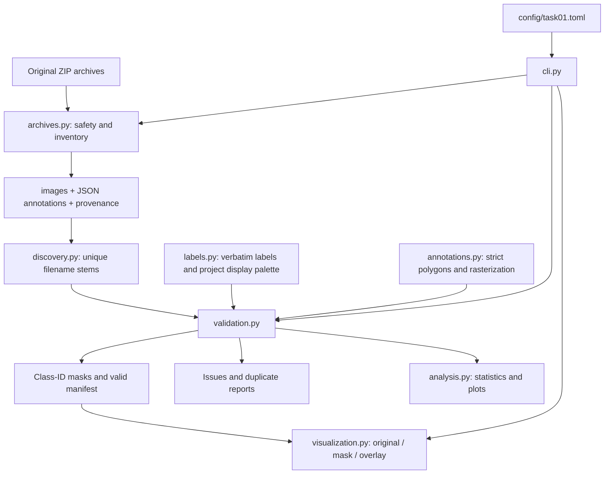
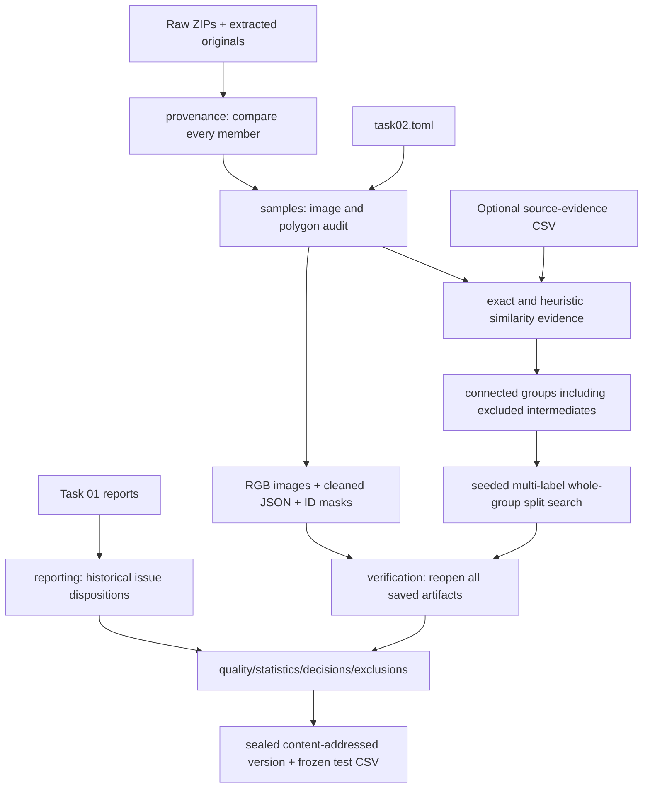
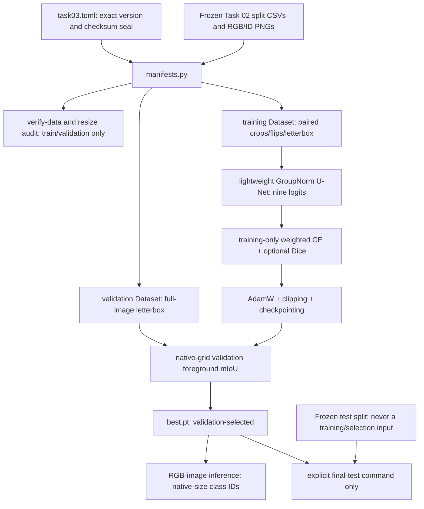
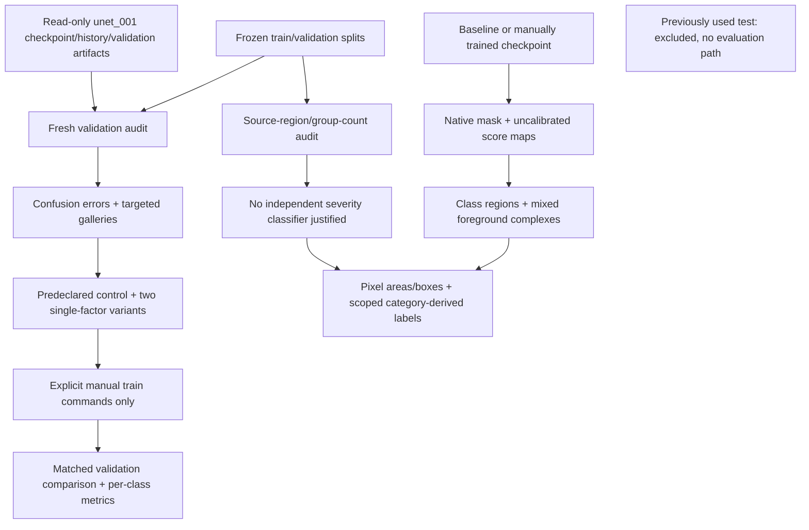

# Architecture and data flow

The installed package uses a `src/` layout: application code lives under
`src/damage_analytics`, separate from tests, documentation, data, and generated files.
The CLI coordinates plain functions; there is no service layer, training framework,
database, or hidden download step.

| Module | Responsibility |
| --- | --- |
| `__init__.py` | Package identity/version without importing heavy dependencies |
| `__main__.py` | Enables `python -m damage_analytics` |
| `cli.py` | Parses a stage/config path, invokes functions, prints concise results and exit status |
| `config.py` | Frozen configuration objects, TOML loading, path resolution and safety checks |
| `labels.py` | Eight source labels, background ID, display colors and provenance notes |
| `io.py` | Streaming SHA-256 and consistent CSV/JSON serialization |
| `archives.py` | ZIP preflight, inventories, size limits, CRC-checked staged extraction |
| `discovery.py` | Supported-file discovery and unambiguous case-sensitive stem matching |
| `annotations.py` | Strict polygon parsing and deterministic rasterization with overlap counting |
| `validation.py` | Full image decoding, schema/geometry checks, duplicate detection, masks and manifest |
| `analysis.py` | Pixel/annotation/dimension aggregates and three headless plots |
| `visualization.py` | Validated manifest consumption, hash checks, colored masks, gallery and sample log |

## Decisions and invariants

- Raw archives are read-only inputs. Extraction never replaces an existing destination.
- Extraction stages both archives beside the destination and renames only after both
  finish. Preflight rejects unsafe member names, links, encrypted entries, filename
  collisions, file/directory conflicts, and excessive sizes/compression ratios.
- Wrapper directories are allowed, but ambiguous stems are errors. Annotation
  `imagePath` is checked by basename only; it is never followed as a filesystem path.
- Polygon labels must match source strings exactly. IDs and RGB display colors are
  assigned by the project; no severity mapping exists.
- Images stay in their stored orientation and resolution. EXIF rotation is not applied.
  Non-default EXIF orientation is reported so alignment can be reviewed.
- Invalid pairs are excluded, errors are reported, and CLI analysis exits with code 2.
  Reports explicitly identify their valid-subset population.
- Later polygons overwrite earlier polygons. Pixels under multiple polygons are counted
  and reported; annotation-level counts remain available before overlap resolution.
- Exact-byte duplicates are checked across extracted files within each role. Paired
  decoded RGB images are additionally compared by pixel hash. These are warnings,
  remain in statistics, and are not automatically deleted.
- Gallery sampling uses a local seeded random generator. Selected images, annotations,
  and masks must still match their recorded hashes. Background remains transparent.
- CSV paths are relative to configured input/output roots. Source absolute paths are
  not embedded in manifests.

## Configuration and dependencies

`config/task01.toml` centralizes locations, expected count, gallery settings, and ZIP
resource limits. `project_root` is resolved relative to that file; other paths are
resolved relative to the project root. Raw/extracted/output directories cannot overlap.
The expected count is an explicit validation check, not a sampling instruction.

The standard library handles CLI parsing, files, ZIPs, JSON, CSV, TOML, hashes, and
sampling. Pillow decodes images and fills polygons. NumPy counts pixels and overlaps.
Matplotlib produces static scientific plots using its noninteractive Agg backend.
Pytest runs lightweight synthetic tests (written with standard-library unittest so
core checks can also run without pytest). Ruff checks style and imports.

Each run processes one image at a time; aggregate records stay in memory, not all
images. Individual image size is guarded by Pillow's decompression-bomb checks.
Run stages sequentially against a given output directory. This is a local research
pipeline foundation, not a concurrent processing service.

## Task 02: curation and frozen splits

Task 01 commands and policies remain available unchanged. Task 02 is a separate
`curation/` subpackage coordinated by the same CLI. It reuses `Config` path loading,
ZIP safety checks, pairing, `Polygon`, source labels, rasterization, and report/hash
utilities. The generic `io.contained_file` helper validates release-relative paths.

| Task 02 module | Responsibility |
| --- | --- |
| `config.py` | Typed cleaning/similarity/split policies and validated output separation |
| `geometry.py` | Area, exact redundant vertices, crossings/touches/retracings |
| `cleaning.py` | Audit every shape, preserve labels, record fixes/acceptances/exclusions |
| `images.py` | Full decoding, format/mode/alpha checks, evidenced EXIF alignment, RGB derivatives |
| `metadata.py` | Available camera/time fields and configurable conservative session-candidate grouping |
| `masks.py` | Task 01 rasterization plus per-class bit-plane checks and annotation thumbnails |
| `samples.py` | Export accepted samples; handle identical-image annotation conflicts and deduplication |
| `similarity.py` | Exact hashes, pHash/dHash/thumbnail candidates, source evidence, transitive components |
| `splitting.py` | Seeded whole-group multi-label search, class-coverage diagnostics, known leakage checks |
| `provenance.py` | Original archive/member integrity, report hashes, config/code/environment release identity |
| `reporting.py` | Complete audit, dispositions, class/co-occurrence/dimension tables |
| `verification.py` | Saved-file hashes, full pixel comparisons, cleaning fidelity, partition/component checks |
| `pipeline.py` | Stage a release, verify/reuse it idempotently, seal it and update the latest pointer |

Task 02 changes image orientation only in derivatives when the annotation dimensions
uniquely match the EXIF-transformed size. It changes polygon representation only under
an explicit policy. Defaults exclude non-simple rings and cross-class raster overlaps;
same-class overlaps remain a union. Task 01's last-polygon-wins rasterizer remains the
underlying drawing rule, but Task 02 does not approve conflicting labels by default.

Grouping is computed across all readable samples before excluded intermediates are
removed. This prevents a path such as retained A → excluded B → retained C from leaking
across splits. Annotation-geometry equality is conservative grouping evidence, not a
claim of common physical source. Near-duplicate candidates are retained and grouped;
unavailable structure identifiers remain an explicit scientific limitation.

Actual camera/time metadata also supplies temporal candidates. Same make/model and
available serial within a configured timestamp gap are conservatively connected.
DateTimeOriginal is preferred; DateTime is an explicitly recorded weaker fallback.
Missing/invalid fields do not create groups. A shared model/time is not treated as
proof of a unique camera or physical structure, and every temporal edge states this.

Release layout is `outputs/task02/versions/<name>-<content-hash>/`. The identity records
all input bytes, settings, seed, Task 01 report hashes, source-evidence hash, package code,
and runtime package versions. No timestamp or absolute machine path affects identity.
Every release file except `checksums.json` is checksummed. Existing versions are
verified and reused, never overwritten. `latest.json` and its companion quality-report
copy are convenience pointers; pin a version and its test CSV hash for research.

Publication is staged on the destination filesystem. Input bytes are rechecked before
publication. Failed source-integrity checks abort publication; quality failures are
reported as `NOT_READY`. Commands sharing an output directory must run sequentially.
This pipeline does not offer a concurrent job scheduler or an adversarial signing system.

Verification compares all mask pixels to re-rasterized cleaned JSON, checks raw-mask
invariance for boundary-preserving cleaning, and verifies exported RGB pixels against
the explicit source-frame policy. It checks class IDs, sizes, background complement,
saved counts, group components, and exact split partitions. This is strong processing
consistency evidence; the same documented Pillow rasterizer is used, so it does not
independently certify polygon edge semantics or human annotation truth.

## Task 03: version-pinned PyTorch segmentation

Task 03 lives entirely in `training/` with a separate `python -m damage_analytics.training`
entrypoint. It leaves Task 01/02 implementations and frozen releases unchanged. The
`training` dependency extra adds torch only; there is no pretrained-weight retrieval.

`manifests.py` authenticates the pinned checksum-manifest digest, sealed metadata and
split hashes, exact labels, partition sizes, and group separation. It never uses the
mutable latest pointer. Selected image/mask contents are rehashed and validated before
opening. Full integrity verification hashes test artifacts as bytes but does not decode
test pixels or generate test statistics/predictions. Normal test sample access is guarded.

`transforms.py` is independent of torch so geometry/resize-loss auditing works without
PyTorch. It records letterbox geometry, applies identical spatial transforms to image and
mask, uses ignored padding, and restores full-image predictions. Crop restoration as an
invented full-image prediction is rejected. `dataset.py` converts arrays to tensors,
seeds workers, and derives augmentation from seed/epoch/sample position rather than
worker scheduling. Variable-resolution native validation masks stay in CPU lists.

`model.py` has configurable channels/depth and small-batch GroupNorm. The default encoder
uses 16/32/64/128 channels; bilinear decoder stages concatenate matching skip features.
The head emits nine logits. `losses.py` supervises resized/cropped masks with weighted CE
and optional present-foreground soft Dice. `weights.py` uses training manifest counts only.
No target normalization, class remapping, split recreation, or severity inference occurs.

`engine.py` handles epoch loops, AdamW, nonfinite-loss/gradient rejection, clipping,
validation, and patience. It saves every strict best validation score while applying
`min_delta` only to patience. `metrics.py` pools int64 confusion counts at native image
resolution before computing per-class metrics. Undefined ratios are JSON null; classes
absent from both sides are excluded from overlap means, while false-positive-only classes
contribute zero. Foreground mIoU excludes background from averaging, not from mistakes.

`experiments.py` records configuration, release/split fingerprints, code hashes, Git commit,
actual environment, seed and device. `runtime.py` selects available MPS/CPU and requests
deterministic operations. `checkpoints.py` atomically saves portable model states plus
optimizer state and loads trusted local files with explicit `weights_only=True`.
No exact resume interface is implemented; cross-device/version bitwise equality is not promised.

`evaluation.py` uses checkpoint-bound preprocessing and training weights, recreates a
full-image validation or explicitly requested final-test loader, and stores immutable
evaluation artifacts under Task 03. It verifies final-test eligibility against completed
normal training's best checkpoint and refuses overfit/synthetic models. `inference.py`
produces ID masks/comparisons without opening known test-release images. `plots.py` keeps
rendering separate from numeric metrics. `smoke.py` is an independent synthetic CPU check.

See [the Task 03 lesson](learning/task_03.md) for tensor examples, model/loss explanations,
complete commands, expected output files, limitations, and interview questions.

## Task 04: controlled improvements and image-space region analytics

Task 04 adds `analytics/` and `config/task04.toml` while preserving all earlier task
implementations and data. The original trained checkpoint is pinned by SHA-256.
The already-executed Task 03 final test is excluded from Task 04 comparisons.

| Module | Responsibility |
| --- | --- |
| `config.py` | New typed policies, exact baseline pin, output isolation, single-factor designs |
| `baseline.py` | Check checkpoint/history/status/report consistency and diagnose errors |
| `validation.py` | Fresh validation inference, independent `add.at` confusion counts and scalar metric cross-check |
| `experiments.py` | Reconstruct saved settings, register changes, audit resolution, explicitly launch manual runs |
| `comparison.py` | Validate matched settings/runtime, compare per-class metrics and paired known-group bootstrap |
| `components.py` | Run-length union-find components without installing SciPy/OpenCV |
| `regions.py` | Exact pixel area, reporting filters, bounding boxes, centroids and mixed complexes |
| `severity.py` | Source-category-only Minor/Moderate labels with mixed/unknown/unsupported states |
| `supervision.py` | Count eligible source regions by image/group and document supervision limitations |
| `inference.py` | Checkpoint/preprocessing provenance, native score restoration and structured reports |
| `review.py` | Explicitly biased worst-case validation galleries for diagnosis |
| `cli.py`, `__main__.py` | Separate Task 04 commands with no final-test branch |

The original U-Net, Dataset, paired transforms, losses, optimizer loop and checkpoint
loading are reused. Controlled experiments alter only existing training settings;
there is no duplicated training loop or silently replaced baseline. All reused helpers
receive a Task 04 output root. A capped-weight variant changes only the CE weight cap;
the spatial variant changes only the model input grid. Same-backend replay separates
historical MPS/current CPU differences from the interventions as far as practical.

The audit regenerates native validation predictions, independently accumulates confusion
counts, verifies scalar mIoU, and seals output artifacts. Half the L1 difference between
count matrices is reported as a reassignment lower bound, not exact aligned prediction
disagreement. A matching count matrix verifies aggregate metrics, not pointwise identity
to historical predictions that were not all retained as ID masks.

Comparison reads only validation results, checks identical samples/native target support,
and requires compatible matched-control training code, package versions and runtime.
The bootstrap resamples known validation components, not pixels or apparently independent
fragments. Its descriptive intervals do not establish training-seed significance,
adjust for adaptive validation selection, or prove unknown-source independence.

Region analytics has two levels: same-class connected components and all-foreground
complexes that expose mixed categories. Connectivity is configurable. Areas/bboxes
remain in the EXIF-oriented native image coordinate frame; all area percentages divide
by full image pixels, including background and non-concrete content. Reporting filters
never edit masks or area totals. No physical calibration is assumed.

Softmax maximum and normalized entropy are computed on the network grid, unpadded and
nearest-restored using the same geometry as class IDs. They are explicitly uncalibrated
review heuristics. A spalling category label is never derived from area or converted
to an image-wide structural grade. Mixed/unsupported/uncertain cases have no single
severity label, and global structural severity is always not assessed.

Source-region supervision audits use train/validation masks only. They retain all
complex dispositions and count unique images/groups to avoid pseudoreplication.
No separate severity classifier is created; the available labels do not independently
supervise overall severity, and minor-spalling validation support is only six known groups.
See [Task 04](learning/task_04.md) for exact commands, observed findings and research limits.

### Task 04 performance extension

The shared training implementation now separates `engine.py` (experiment orchestration)
from `epochs.py` (one numerically checked pass). `engine.run_epoch` remains importable
for earlier callers. Model architecture, original checkpoints and frozen splits are
unchanged. `selection.py` makes validation cadence and check-based patience explicit;
the default still validates every epoch. Unvalidated history/checkpoint scores are null.

`dataset.py` shares the current epoch with persistent spawned workers, and decouples
shuffle order from worker lifetime while replaying the historical completed-epoch order.
`cache.py` provides an optional bounded native-pair LRU with hash verification on hits.
Cache budgets apply per dataset per process, rather than globally across a loader pool.

`profiling.py` orchestrates bounded real-data probes through `profile_steps.py`,
`timing.py` and `memory.py`. Detailed stages use MPS barriers; whole-pass throughput
probes synchronize only at their boundaries. `profile_reports.py` produces measured
CSV summaries. The profiler never writes training checkpoints or opens test samples.
Its artifacts are isolated under `outputs/task04/performance/`.

`config/task04.toml` owns execution policies and the shared training schedule.
Explicit MPS training may opt out of strict determinism; the unchanged U-Net's bilinear
upsampling backward is unsupported under strict MPS determinism in the measured build.
Matched comparisons additionally enforce equal epoch budgets, batch sizes, validation
cadences and execution policies. The historical CPU `control_s42` is retained, not
misrepresented as a matched reference for a new MPS cohort.

See [the performance lesson](learning/task_04_performance.md) for measured timings,
memory caveats, benchmark commands and the manual pilot/full-experiment workflow.
