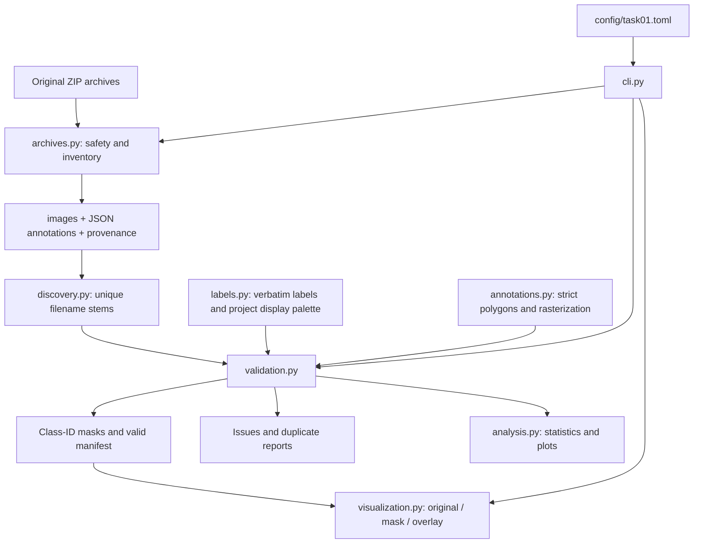
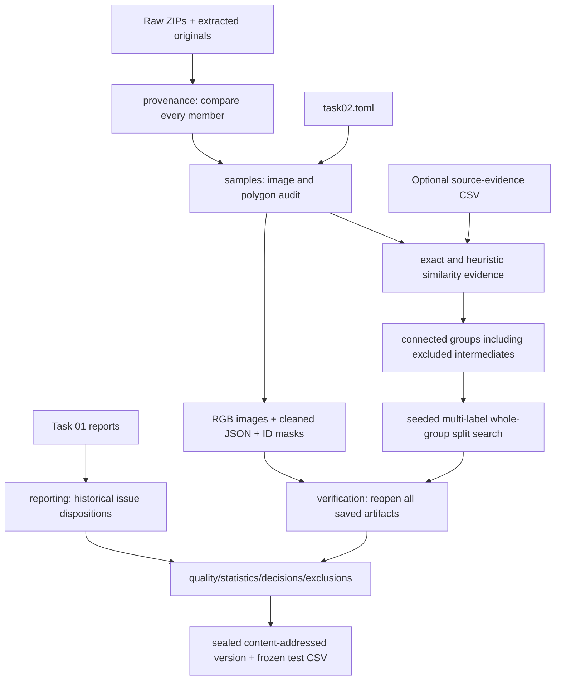

# Architecture and data flow

The installed package uses a `src/` layout: application code lives under
`src/damage_analytics`, separate from tests, documentation, data, and generated files.
The CLI coordinates plain functions; there is no service layer, training framework,
database, or hidden download step.

| Module | Responsibility |
| --- | --- |
| `__init__.py` | Package identity/version without importing heavy dependencies |
| `__main__.py` | Enables `python -m damage_analytics` |
| `cli.py` | Parses a stage/config path, invokes functions, prints concise results and exit status |
| `config.py` | Frozen configuration objects, TOML loading, path resolution and safety checks |
| `labels.py` | Eight source labels, background ID, display colors and provenance notes |
| `io.py` | Streaming SHA-256 and consistent CSV/JSON serialization |
| `archives.py` | ZIP preflight, inventories, size limits, CRC-checked staged extraction |
| `discovery.py` | Supported-file discovery and unambiguous case-sensitive stem matching |
| `annotations.py` | Strict polygon parsing and deterministic rasterization with overlap counting |
| `validation.py` | Full image decoding, schema/geometry checks, duplicate detection, masks and manifest |
| `analysis.py` | Pixel/annotation/dimension aggregates and three headless plots |
| `visualization.py` | Validated manifest consumption, hash checks, colored masks, gallery and sample log |

## Decisions and invariants

- Raw archives are read-only inputs. Extraction never replaces an existing destination.
- Extraction stages both archives beside the destination and renames only after both
  finish. Preflight rejects unsafe member names, links, encrypted entries, filename
  collisions, file/directory conflicts, and excessive sizes/compression ratios.
- Wrapper directories are allowed, but ambiguous stems are errors. Annotation
  `imagePath` is checked by basename only; it is never followed as a filesystem path.
- Polygon labels must match source strings exactly. IDs and RGB display colors are
  assigned by the project; no severity mapping exists.
- Images stay in their stored orientation and resolution. EXIF rotation is not applied.
  Non-default EXIF orientation is reported so alignment can be reviewed.
- Invalid pairs are excluded, errors are reported, and CLI analysis exits with code 2.
  Reports explicitly identify their valid-subset population.
- Later polygons overwrite earlier polygons. Pixels under multiple polygons are counted
  and reported; annotation-level counts remain available before overlap resolution.
- Exact-byte duplicates are checked across extracted files within each role. Paired
  decoded RGB images are additionally compared by pixel hash. These are warnings,
  remain in statistics, and are not automatically deleted.
- Gallery sampling uses a local seeded random generator. Selected images, annotations,
  and masks must still match their recorded hashes. Background remains transparent.
- CSV paths are relative to configured input/output roots. Source absolute paths are
  not embedded in manifests.

## Configuration and dependencies

`config/task01.toml` centralizes locations, expected count, gallery settings, and ZIP
resource limits. `project_root` is resolved relative to that file; other paths are
resolved relative to the project root. Raw/extracted/output directories cannot overlap.
The expected count is an explicit validation check, not a sampling instruction.

The standard library handles CLI parsing, files, ZIPs, JSON, CSV, TOML, hashes, and
sampling. Pillow decodes images and fills polygons. NumPy counts pixels and overlaps.
Matplotlib produces static scientific plots using its noninteractive Agg backend.
Pytest runs lightweight synthetic tests (written with standard-library unittest so
core checks can also run without pytest). Ruff checks style and imports.

Each run processes one image at a time; aggregate records stay in memory, not all
images. Individual image size is guarded by Pillow's decompression-bomb checks.
Run stages sequentially against a given output directory. This is a local research
pipeline foundation, not a concurrent processing service.

## Task 02: curation and frozen splits

Task 01 commands and policies remain available unchanged. Task 02 is a separate
`curation/` subpackage coordinated by the same CLI. It reuses `Config` path loading,
ZIP safety checks, pairing, `Polygon`, source labels, rasterization, and report/hash
utilities. The generic `io.contained_file` helper validates release-relative paths.

| Task 02 module | Responsibility |
| --- | --- |
| `config.py` | Typed cleaning/similarity/split policies and validated output separation |
| `geometry.py` | Area, exact redundant vertices, crossings/touches/retracings |
| `cleaning.py` | Audit every shape, preserve labels, record fixes/acceptances/exclusions |
| `images.py` | Full decoding, format/mode/alpha checks, evidenced EXIF alignment, RGB derivatives |
| `metadata.py` | Available camera/time fields and configurable conservative session-candidate grouping |
| `masks.py` | Task 01 rasterization plus per-class bit-plane checks and annotation thumbnails |
| `samples.py` | Export accepted samples; handle identical-image annotation conflicts and deduplication |
| `similarity.py` | Exact hashes, pHash/dHash/thumbnail candidates, source evidence, transitive components |
| `splitting.py` | Seeded whole-group multi-label search, class-coverage diagnostics, known leakage checks |
| `provenance.py` | Original archive/member integrity, report hashes, config/code/environment release identity |
| `reporting.py` | Complete audit, dispositions, class/co-occurrence/dimension tables |
| `verification.py` | Saved-file hashes, full pixel comparisons, cleaning fidelity, partition/component checks |
| `pipeline.py` | Stage a release, verify/reuse it idempotently, seal it and update the latest pointer |

Task 02 changes image orientation only in derivatives when the annotation dimensions
uniquely match the EXIF-transformed size. It changes polygon representation only under
an explicit policy. Defaults exclude non-simple rings and cross-class raster overlaps;
same-class overlaps remain a union. Task 01's last-polygon-wins rasterizer remains the
underlying drawing rule, but Task 02 does not approve conflicting labels by default.

Grouping is computed across all readable samples before excluded intermediates are
removed. This prevents a path such as retained A → excluded B → retained C from leaking
across splits. Annotation-geometry equality is conservative grouping evidence, not a
claim of common physical source. Near-duplicate candidates are retained and grouped;
unavailable structure identifiers remain an explicit scientific limitation.

Actual camera/time metadata also supplies temporal candidates. Same make/model and
available serial within a configured timestamp gap are conservatively connected.
DateTimeOriginal is preferred; DateTime is an explicitly recorded weaker fallback.
Missing/invalid fields do not create groups. A shared model/time is not treated as
proof of a unique camera or physical structure, and every temporal edge states this.

Release layout is `outputs/task02/versions/<name>-<content-hash>/`. The identity records
all input bytes, settings, seed, Task 01 report hashes, source-evidence hash, package code,
and runtime package versions. No timestamp or absolute machine path affects identity.
Every release file except `checksums.json` is checksummed. Existing versions are
verified and reused, never overwritten. `latest.json` and its companion quality-report
copy are convenience pointers; pin a version and its test CSV hash for research.

Publication is staged on the destination filesystem. Input bytes are rechecked before
publication. Failed source-integrity checks abort publication; quality failures are
reported as `NOT_READY`. Commands sharing an output directory must run sequentially.
This pipeline does not offer a concurrent job scheduler or an adversarial signing system.

Verification compares all mask pixels to re-rasterized cleaned JSON, checks raw-mask
invariance for boundary-preserving cleaning, and verifies exported RGB pixels against
the explicit source-frame policy. It checks class IDs, sizes, background complement,
saved counts, group components, and exact split partitions. This is strong processing
consistency evidence; the same documented Pillow rasterizer is used, so it does not
independently certify polygon edge semantics or human annotation truth.
