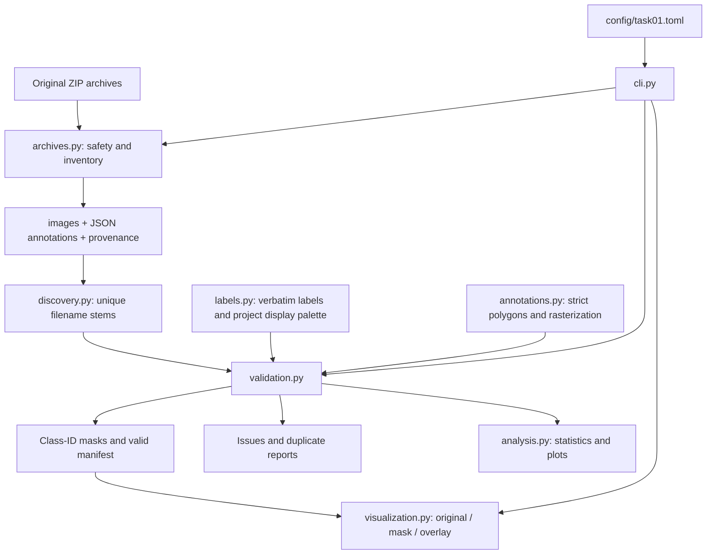

# Architecture and data flow

The installed package uses a `src/` layout: application code lives under
`src/damage_analytics`, separate from tests, documentation, data, and generated files.
The CLI coordinates plain functions; there is no service layer, training framework,
database, or hidden download step.

| Module | Responsibility |
| --- | --- |
| `__init__.py` | Package identity/version without importing heavy dependencies |
| `__main__.py` | Enables `python -m damage_analytics` |
| `cli.py` | Parses a stage/config path, invokes functions, prints concise results and exit status |
| `config.py` | Frozen configuration objects, TOML loading, path resolution and safety checks |
| `labels.py` | Eight source labels, background ID, display colors and provenance notes |
| `io.py` | Streaming SHA-256 and consistent CSV/JSON serialization |
| `archives.py` | ZIP preflight, inventories, size limits, CRC-checked staged extraction |
| `discovery.py` | Supported-file discovery and unambiguous case-sensitive stem matching |
| `annotations.py` | Strict polygon parsing and deterministic rasterization with overlap counting |
| `validation.py` | Full image decoding, schema/geometry checks, duplicate detection, masks and manifest |
| `analysis.py` | Pixel/annotation/dimension aggregates and three headless plots |
| `visualization.py` | Validated manifest consumption, hash checks, colored masks, gallery and sample log |

## Decisions and invariants

- Raw archives are read-only inputs. Extraction never replaces an existing destination.
- Extraction stages both archives beside the destination and renames only after both
  finish. Preflight rejects unsafe member names, links, encrypted entries, filename
  collisions, file/directory conflicts, and excessive sizes/compression ratios.
- Wrapper directories are allowed, but ambiguous stems are errors. Annotation
  `imagePath` is checked by basename only; it is never followed as a filesystem path.
- Polygon labels must match source strings exactly. IDs and RGB display colors are
  assigned by the project; no severity mapping exists.
- Images stay in their stored orientation and resolution. EXIF rotation is not applied.
  Non-default EXIF orientation is reported so alignment can be reviewed.
- Invalid pairs are excluded, errors are reported, and CLI analysis exits with code 2.
  Reports explicitly identify their valid-subset population.
- Later polygons overwrite earlier polygons. Pixels under multiple polygons are counted
  and reported; annotation-level counts remain available before overlap resolution.
- Exact-byte duplicates are checked across extracted files within each role. Paired
  decoded RGB images are additionally compared by pixel hash. These are warnings,
  remain in statistics, and are not automatically deleted.
- Gallery sampling uses a local seeded random generator. Selected images, annotations,
  and masks must still match their recorded hashes. Background remains transparent.
- CSV paths are relative to configured input/output roots. Source absolute paths are
  not embedded in manifests.

## Configuration and dependencies

`config/task01.toml` centralizes locations, expected count, gallery settings, and ZIP
resource limits. `project_root` is resolved relative to that file; other paths are
resolved relative to the project root. Raw/extracted/output directories cannot overlap.
The expected count is an explicit validation check, not a sampling instruction.

The standard library handles CLI parsing, files, ZIPs, JSON, CSV, TOML, hashes, and
sampling. Pillow decodes images and fills polygons. NumPy counts pixels and overlaps.
Matplotlib produces static scientific plots using its noninteractive Agg backend.
Pytest runs lightweight synthetic tests (written with standard-library unittest so
core checks can also run without pytest). Ruff checks style and imports.

Each run processes one image at a time; aggregate records stay in memory, not all
images. Individual image size is guarded by Pillow's decompression-bomb checks.
Run stages sequentially against a given output directory. This is a local research
pipeline foundation, not a concurrent processing service.
